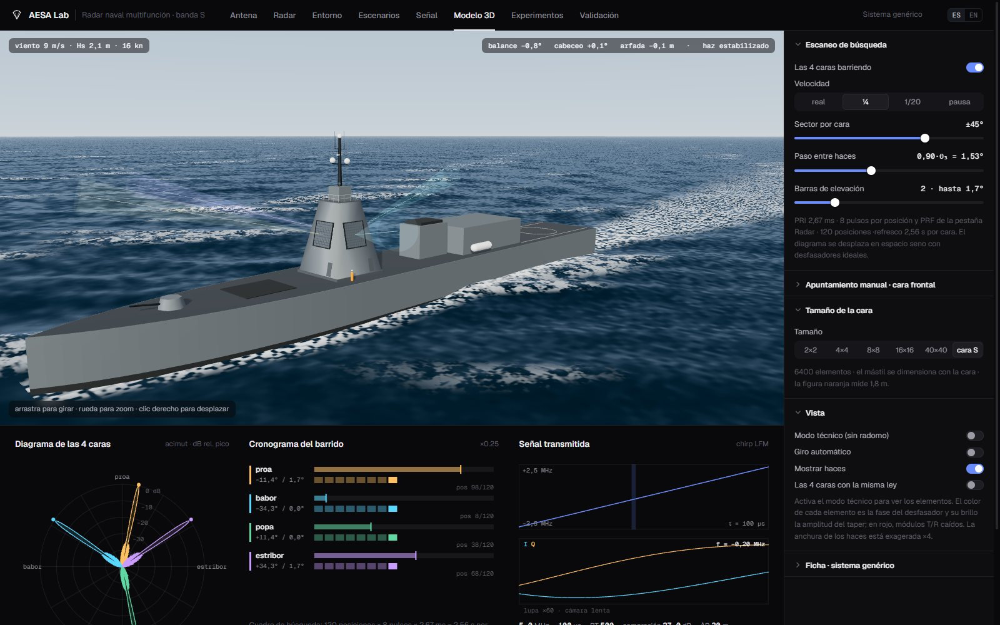
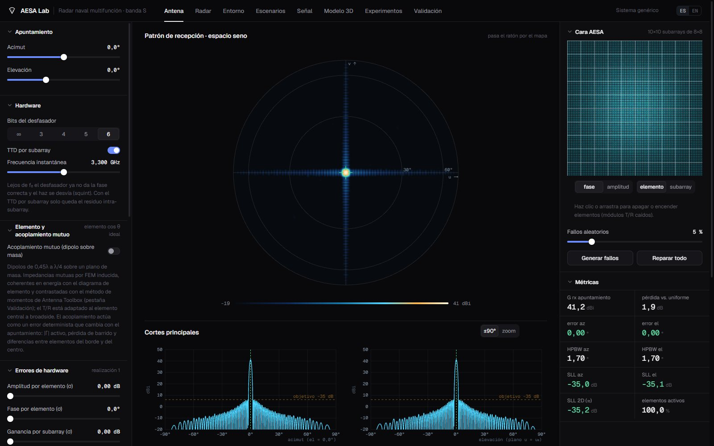
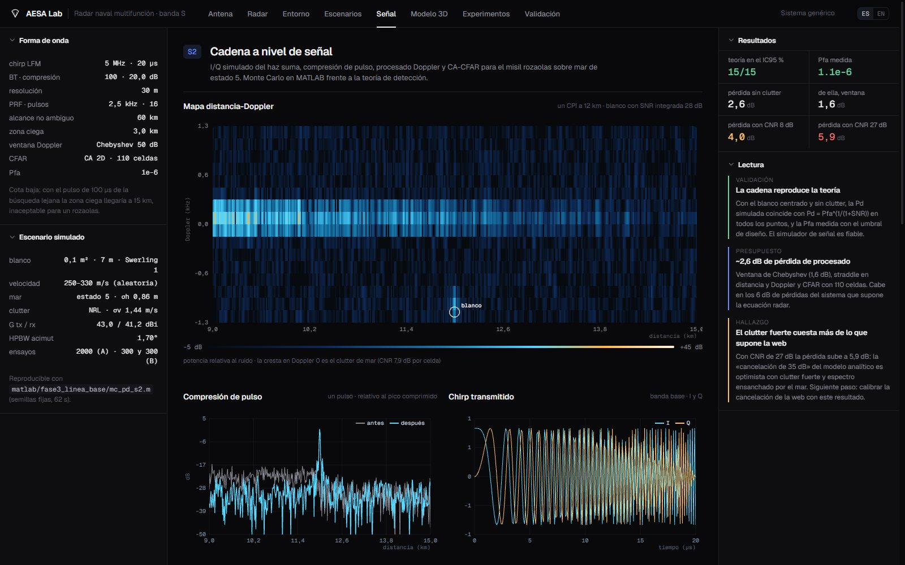
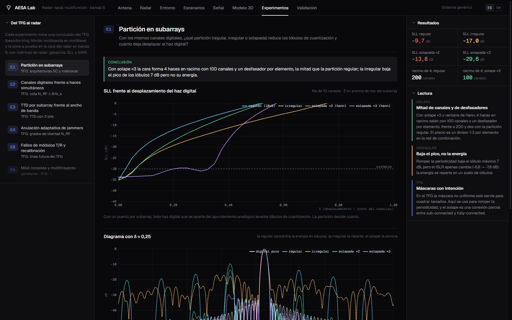
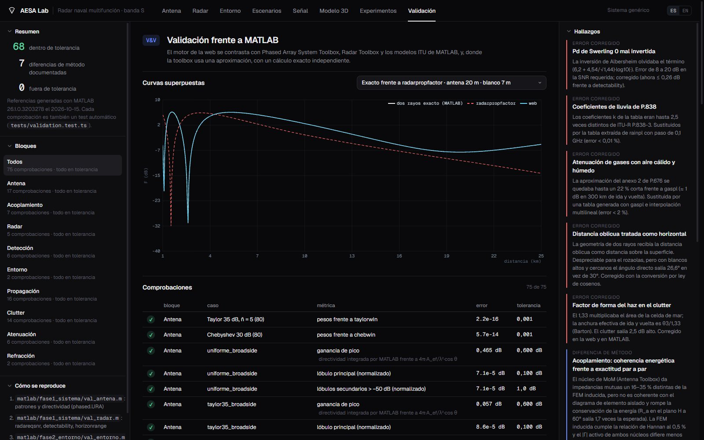

# AESA Lab · Radar naval AESA con beamforming híbrido por subarrays

[English](README.md) · **Español**


Continuación de mi TFG (*Desarrollo y evaluación de esquemas de beamforming híbrido de múltiples bandas*, ETSIT-UPM, 2026). El TFG diseñó una etapa analógica compartida para tres bandas mmWave. Aquí llevo sus conclusiones a un **radar naval multifunción AESA genérico en banda S**: 4 caras de 80×80 elementos agrupados en subarrays de 8×8. Cada regla del TFG se vuelve a comprobar con métricas de radar (ganancia, lóbulos secundarios, SINR).

El proyecto tiene dos partes:
- **MATLAB** es el laboratorio: Monte Carlo, toolboxes y experimentos.
- **AESA Lab** es el simulador web interactivo. Su motor se valida automáticamente contra MATLAB.



> **Aviso.** Es un sistema genérico con parámetros supuestos, valores típicos de su clase tomados de bibliografía abierta. No representa a ningún radar ni fabricante real y no contiene ni estima prestaciones de sistemas reales.

---

## De un vistazo

| | |
|---|---|
| **Sistema** | Banda S (3,3 GHz), 4 caras, 6400 elementos por cara, 100 subarrays de 8×8, Taylor −35 dB, desfasadores de 6 bits, TTD por subarray |
| **Verificación** | 75 comprobaciones del motor web frente a Phased Array System Toolbox, Radar Toolbox y modelos ITU; ninguna fuera de tolerancia. Cinco errores reales corregidos gracias a ellas |
| **Cadena de señal** | Simulación I/Q con chirp LFM, procesado Doppler y CA-CFAR 2D. La Pd por Monte Carlo cae dentro del IC95 % de la teoría en 15 de 15 puntos |
| **Experimentos** | Cinco experimentos que llevan reglas del TFG al radar: canales digitales, partición en subarrays, TTD, anulación de jammers y fallos de módulos T/R |
| **Ampliación del TFG** | La cota N_RF ≥ B·N_s se mantiene con acoplamiento mutuo real |
| **Documentación** | [Modelos y fórmulas](docs/modelos_y_formulas.md): cada fórmula del código con su referencia, sus supuestos y sus límites |
| **Web** | Simulador en el navegador, bilingüe ES/EN, con 73 tests automáticos |

---

## 1 · Del TFG al radar

| Regla del TFG (mmWave, 8×8, 3 bandas) | Pregunta en el radar | Resultado | Script |
|---|---|---|---|
| **E2** · cota N_RF ≥ B·N_s | ¿Cuántos canales digitales para K haces simultáneos? | La cota pasa a **M ≥ min(K, r_eff) puertos por subarray**: 200 canales para 4 haces en racimo, frente a 6400. Es exacta en 56 de 64 casos y nunca se viola. Lo que limita es el SLL, no la ganancia | [`e2_canales_haces.m`](matlab/fase4_optimizacion/e2_canales_haces.m) |
| **E1** · arquitecturas sub-connected | ¿Qué partición reduce los lóbulos de cuantización? | Con **subarrays solapados ×3**, 4 haces caben en 1 puerto por subarray (100 canales). La partición irregular baja el pico 7 dB pero no la energía | [`e1_particion_subarrays.m`](matlab/fase4_optimizacion/e1_particion_subarrays.m) |
| **E3** · TTD con 3 bits | ¿Cuándo hace falta TTD, a qué nivel y con cuántos bits? | A 60°: 58 MHz sin TTD; el TTD por subarray de 8×8 queda limitado a **47 MHz** por lóbulos de cuantización; por elemento, 335 MHz. Hacen falta **4–5 bits**: los 3 del TFG eran un caso particular | [`e3_ttd_ancho_banda.m`](matlab/fase4_optimizacion/e3_ttd_ancho_banda.m) |
| **E4** · canales = grados de libertad | ¿Cuántos jammers anula la cara con 100 salidas de subarray? | El MVDR con patrón quiescente anula **130 jammers con < 1 dB** de pérdida (JNR 30 dB). Su punto débil son los pares de jammers separados λ/(L·d) | [`e4_anulacion_jammer.m`](matlab/fase4_optimizacion/e4_anulacion_jammer.m) |
| **E6** · línea futura: fallos | ¿Cuánto degradan los módulos caídos y cuánto recupera la calibración? | Con un 10 % caídos el SLL pasa de −35,1 a −33,2 dB, y **el re-taper lo devuelve a −35,1 dB**. Un subarray caído entero cuesta 7 veces más que los mismos elementos al azar | [`e6_robustez_fallos.m`](matlab/fase4_optimizacion/e6_robustez_fallos.m) |


**Hilo común.** Los lóbulos de E2, el límite del TTD en E3 y el punto débil del adaptativo en E4 son el mismo fenómeno: la red de subarrays muestrea la apertura con paso L·d. El solape de E1 es la solución común. Las fórmulas cerradas (Reed-Mallett-Brennan, momentos de los errores, factor de Bernoulli) coinciden con el Monte Carlo dentro de su IC95 %.

Cada experimento se reproduce con un solo script y tiene su página en la pestaña **Experimentos** de la web. Su modelo y sus fórmulas están en [`docs/modelos_y_formulas.md`](docs/modelos_y_formulas.md) (§28–§32).

### Respuesta a la crítica del tribunal: acoplamiento mutuo

*«En un entorno real, los efectos electromagnéticos de la multibanda se lo comerían todo.»* Para comprobarlo, repetí el experimento final del TFG con impedancias mutuas entre dipolos reales sobre plano de masa (FEM inducida, validada con Hannan y con el MoM de Antenna Toolbox).

| | Error con 12 cadenas |
|---|---|
| Modelo ideal (TFG) | 0,047 |
| Con acoplamiento, sin compensar | 0,138 |
| Con acoplamiento, compensado en la etapa digital | 0,092; el codo sigue en 12 cadenas |

**La conclusión del TFG se mantiene.** Script: [`acoplamiento_tfg.m`](matlab/fase5_ampliacion_tfg/acoplamiento_tfg.m).


---

## 2 · El simulador web

<table>
<tr>
<td width="50%"><br><b>Antena.</b> El diagrama de los 6400 elementos se recalcula en tiempo real. Se pueden ajustar los bits, el TTD, el squint, los errores de calibración, los módulos caídos (con el ratón), el acoplamiento y el monopulso.</td>
<td width="50%"><br><b>Señal.</b> Cadena I/Q del misil rozaolas: compresión de pulso, mapa distancia-Doppler y CFAR, con las pérdidas de procesado medidas.</td>
</tr>
<tr>
<td><br><b>Experimentos.</b> E1–E4 y E6. Cada uno muestra la regla del TFG de la que parte, la pregunta, la conclusión y sus figuras.</td>
<td><br><b>Validación.</b> Cada curva del motor aparece superpuesta a su referencia de MATLAB, con la tabla de comprobaciones y los errores corregidos.</td>
</tr>
</table>

Además de esas pestañas:
- **Radar:** ecuación radar y detección (Swerling 0/1, Albersheim).
- **Entorno:** viento y oleaje; refracción; ecuación parabólica con conducto de evaporación y capa de inversión; gases y lluvia ITU-R; clutter de mar K-distribuido; multitrayecto.
- **Escenarios:** S1, S2 y S5, con barridos de cualquier parámetro.
- **Modelo 3D:** buque con movimiento y estabilización del haz, y búsqueda de 360° con las cuatro caras.

---

## 3 · Verificación

La validación funciona así:
1. [`matlab/validacion_web.m`](matlab/validacion_web.m) genera vectores de referencia con las toolboxes.
2. `npm test` los compara con el motor TypeScript en cada cambio.

| Bloque | Referencia | Casos |
|---|---|---:|
| Antena | `phased.URA`, `taylorwin`, `chebwin` | 17 |
| Acoplamiento | Hannan y MoM (Antenna Toolbox) | 7 |
| Radar | `radareqsnr` | 5 |
| Detección | `detectability`, Swerling 0 y 1 | 6 |
| Propagación | dos rayos exacto, `radarpropfactor` | 16 |
| Clutter de mar | `seareflectivity` (NRL), ITU-R P.527 | 14 |
| Atenuación | `gaspl` (P.676), `rainpl` (P.838) | 6 |
| Refracción | `horizonrange`, `effearthradius` | 4 |

Errores reales que encontró la validación:
- **Pd de Swerling 0:** faltaba un término en la inversión de Albersheim (8–20 dB de error).
- **Lluvia, ITU-R P.838:** coeficientes hasta 2,5 veces distintos.
- **Gases, ITU-R P.676:** la atenuación salía un 22 % corta con aire cálido y húmedo.
- **Dos rayos:** la distancia oblicua se trataba como horizontal.
- **Clutter:** el factor de forma del haz daba 2,5 dB de más.

---

## 4 · Cómo ejecutarlo

**Web** (requiere Node 20 o superior):

```bash
cd web
npm ci
npm run dev        # http://localhost:5173 · ?lang=es para la versión en español
npm test           # 73 tests, incluida la validación frente a MATLAB
```

En Windows también se puede usar `AESA-Lab.bat`, que levanta el servidor y abre el navegador.

**MATLAB** (R2026a con Phased Array System Toolbox, Radar Toolbox y Antenna Toolbox):

```matlab
cd matlab
startup                                          % rutas y sistema de referencia
run('fase4_optimizacion/e2_canales_haces.m')     % cualquier experimento: figura + JSON para la web
run('validacion_web.m')                          % regenera las referencias de la validación
```

Cada script es determinista (semillas fijas). Escribe sus figuras en `matlab/results/`, que git ignora, y sus datos en `web/src/data/`.

---

## 5 · Estructura

```
├── matlab/
│   ├── config/sistema_ref.m      sistema de referencia (un único sitio)
│   ├── lib/                      librería del TFG reutilizada y ampliada (core, radar, em, propagación…)
│   ├── fase1_sistema/            antena, radar, acoplamiento, monopulso: validación
│   ├── fase2_entorno/            ecuación parabólica, gases, entorno: validación
│   ├── fase3_linea_base/         cadena de señal S2, clutter K, ruido de fase, pérdidas
│   ├── fase4_optimizacion/       experimentos E1–E4 y E6
│   ├── fase5_ampliacion_tfg/     TFG con acoplamiento mutuo
│   └── validacion_web.m          vectores de referencia para los tests de la web
├── web/                          AESA Lab (Vite + React + TypeScript + Three.js)
│   ├── src/engine/               motor: array, radar, entorno, EP, clutter, errores, monopulso
│   ├── src/views/                pestañas
│   ├── src/data/                 resultados exportados desde MATLAB
│   └── tests/                    tests de Vitest (incluida la validación)
└── docs/
    ├── modelos_y_formulas.md     cada modelo y fórmula del código, con su referencia y sus supuestos (§1–§32)
    ├── models_and_formulas.md    lo mismo, en inglés
    └── img/                      capturas de este README
```

---

**David Castro**: Ingeniería de Tecnologías y Servicios de Telecomunicación, ETSIT-UPM · [github.com/SunTzuUET](https://github.com/SunTzuUET) · TFG: [TFG_David_Castro](https://github.com/SunTzuUET/TFG_David_Castro)
