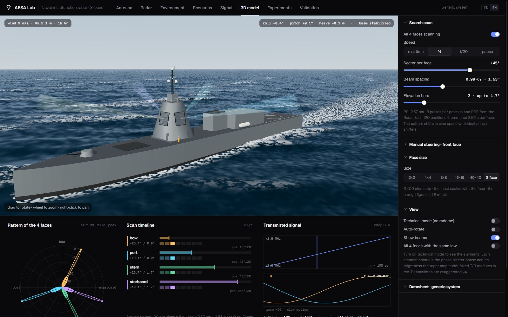
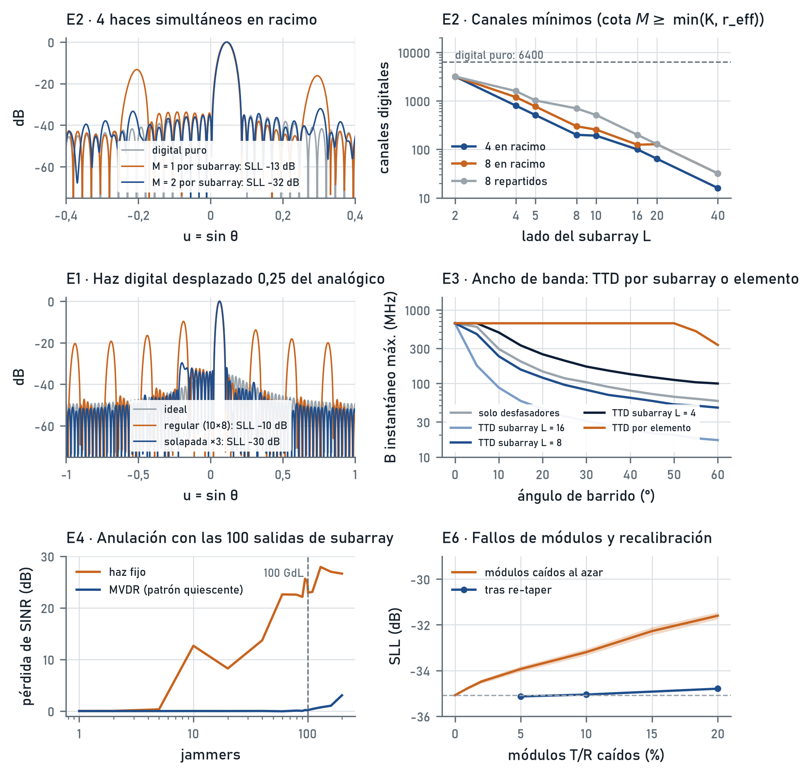
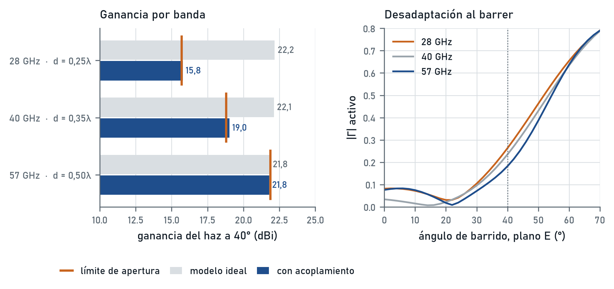
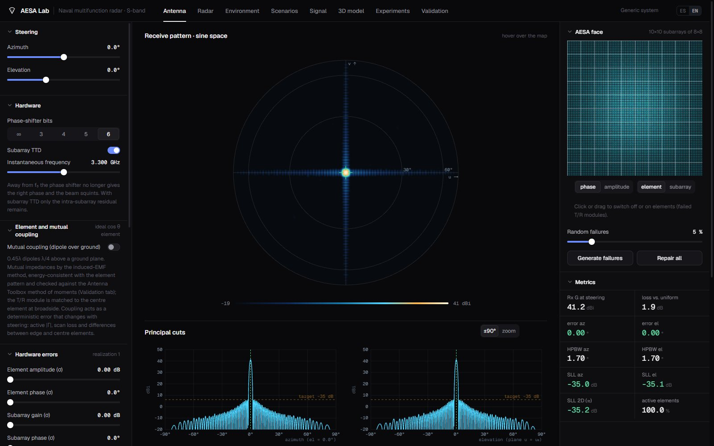
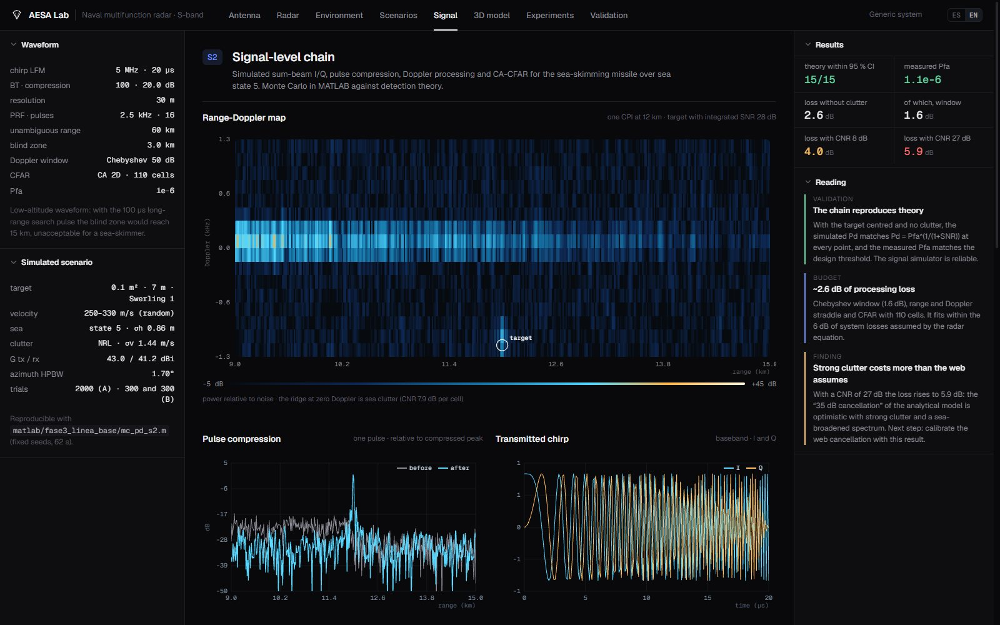
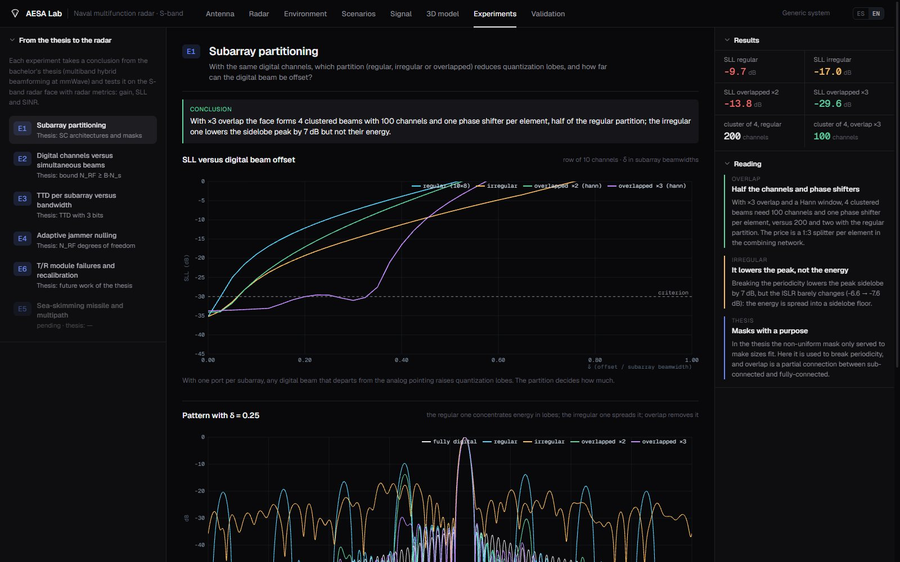
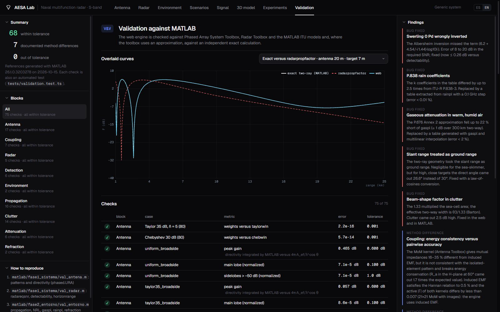

# AESA Lab · Naval AESA radar with subarray hybrid beamforming

**English** · [Español](README.es.md)


This project continues my bachelor's thesis (*Design and evaluation of multiband hybrid beamforming schemes*, ETSIT-UPM, 2026). The thesis designed one analog stage shared by three mmWave bands.

Here its conclusions are carried over to a **generic S-band multifunction naval AESA radar**: 4 faces of 80×80 elements, grouped into 8×8 subarrays. Each rule from the thesis is checked again with radar metrics: gain, sidelobes and SINR.

The project has two parts:
- **MATLAB** is the lab: Monte Carlo runs, toolboxes and experiments.
- **AESA Lab** is the interactive web simulator. Its engine is validated automatically against MATLAB.



> **Disclaimer.** This is a generic system. Its parameters are assumed, using values typical of its class taken from open literature. It does not represent any real radar or manufacturer, and it neither contains nor estimates the performance of real systems.

---

## At a glance

| | |
|---|---|
| **System** | S-band (3.3 GHz), 4 faces, 6400 elements per face, 100 subarrays of 8×8, Taylor −35 dB, 6-bit phase shifters, true time delay per subarray |
| **Verification** | 75 checks of the web engine against Phased Array System Toolbox, Radar Toolbox and ITU models; none out of tolerance. They exposed five real bugs, all fixed |
| **Signal chain** | I/Q simulation: LFM chirp, Doppler processing, 2D CA-CFAR. Monte Carlo Pd falls within the 95 % CI of theory at 15 of 15 points |
| **Experiments** | Five experiments that carry thesis rules over to the radar: digital channels, subarray partition, TTD, jammer nulling, T/R module failures |
| **Thesis extension** | The bound N_RF ≥ B·N_s holds with real mutual coupling |
| **Documentation** | [Models and formulas](docs/models_and_formulas.md): every formula in the code with its reference, assumptions and limits |
| **Web** | In-browser simulator, bilingual ES/EN, 73 automated tests |

---

## 1 · From the thesis to the radar

| Thesis rule (mmWave, 8×8, 3 bands) | Question for the radar | Result | Script |
|---|---|---|---|
| **E2** · bound N_RF ≥ B·N_s | How many digital channels for K simultaneous beams? | The bound becomes **M ≥ min(K, r_eff) ports per subarray**: 200 channels for 4 clustered beams versus 6400. It is exact in 56 of 64 cases and never violated. The limit is set by the SLL, not by gain | [`e2_canales_haces.m`](matlab/fase4_optimizacion/e2_canales_haces.m) |
| **E1** · sub-connected architectures | Which partition reduces quantization lobes? | With **3× overlapped subarrays**, 4 beams fit in 1 port per subarray (100 channels). An irregular partition lowers the peak by 7 dB, but not the energy | [`e1_particion_subarrays.m`](matlab/fase4_optimizacion/e1_particion_subarrays.m) |
| **E3** · 3-bit TTD | When is TTD needed, at what level, and with how many bits? | At 60°: 58 MHz without TTD; TTD per 8×8 subarray is limited to **47 MHz** by quantization lobes; per element, 335 MHz. It takes **4–5 bits**: the thesis's 3 bits were a special case | [`e3_ttd_ancho_banda.m`](matlab/fase4_optimizacion/e3_ttd_ancho_banda.m) |
| **E4** · channels = degrees of freedom | How many jammers can 100 subarray outputs null? | MVDR with a quiescent-pattern constraint nulls **130 jammers with < 1 dB** SINR loss (JNR 30 dB). Its weak spot: jammer pairs spaced λ/(L·d) apart | [`e4_anulacion_jammer.m`](matlab/fase4_optimizacion/e4_anulacion_jammer.m) |
| **E6** · future work: failures | How much do failed modules degrade the face, and how much does recalibration recover? | With 10 % of modules failed, the SLL rises from −35.1 to −33.2 dB; **re-tapering brings it back to −35.1 dB**. A whole failed subarray costs 7 times more than the same number of random elements | [`e6_robustez_fallos.m`](matlab/fase4_optimizacion/e6_robustez_fallos.m) |



**Common thread.** Three results share one cause: the lobes in E2, the TTD limit in E3 and the adaptive beamformer's weak spot in E4. In all three, the subarray lattice samples the aperture with pitch L·d. The overlap from E1 is the shared fix. The closed-form results (Reed-Mallett-Brennan, error moments, Bernoulli factor) match Monte Carlo within their 95 % CI.

Each experiment is reproduced by a single script and has its own page in the web's **Experiments** tab. Models and formulas are in [`docs/models_and_formulas.md`](docs/models_and_formulas.md) (§28–§32).

### Answering the examiners: mutual coupling

*"In a real environment, the electromagnetic effects of multiband operation would eat everything up."*

To test this, I reran the thesis's final experiment with the mutual impedances of real dipoles over a ground plane. The impedances come from the induced-EMF method, validated against Hannan and the Antenna Toolbox MoM.

| | Error with 12 RF chains |
|---|---|
| Ideal model (thesis) | 0.047 |
| With coupling, uncompensated | 0.138 |
| With coupling, compensated in the digital stage | 0.092; the knee stays at 12 chains |

**The thesis conclusion holds.** Script: [`acoplamiento_tfg.m`](matlab/fase5_ampliacion_tfg/acoplamiento_tfg.m).



---

## 2 · The web simulator

<table>
<tr>
<td width="50%"><br><b>Antenna.</b> The 6400-element pattern is recomputed in real time. You can adjust phase bits, TTD, squint, calibration errors, coupling and monopulse, and switch T/R modules off with the mouse.</td>
<td width="50%"><br><b>Signal.</b> I/Q chain for the sea-skimming missile: pulse compression, range-Doppler map and CFAR, with measured processing losses.</td>
</tr>
<tr>
<td><br><b>Experiments.</b> E1–E4 and E6. Each one shows the thesis rule it starts from, the question, the conclusion and its figures.</td>
<td><br><b>Validation.</b> Each engine curve is overlaid on its MATLAB reference, with the table of checks and the bugs that were fixed.</td>
</tr>
</table>

The other tabs:
- **Radar:** radar equation and detection (Swerling 0/1, Albersheim).
- **Environment:**
  - wind and waves
  - refraction
  - parabolic equation with evaporation duct and inversion layer
  - ITU-R gases and rain
  - K-distributed sea clutter
  - multipath
- **Scenarios:** S1, S2 and S5, with sweeps over any parameter.
- **3D model:** ship motion with beam stabilization, and a 360° search with all four faces.

---

## 3 · Verification

How the check works:
1. [`matlab/validacion_web.m`](matlab/validacion_web.m) generates reference vectors with the toolboxes.
2. `npm test` compares the TypeScript engine against them on every change.

| Block | Reference | Cases |
|---|---|---:|
| Antenna | `phased.URA`, `taylorwin`, `chebwin` | 17 |
| Coupling | Hannan and MoM (Antenna Toolbox) | 7 |
| Radar | `radareqsnr` | 5 |
| Detection | `detectability`, Swerling 0 and 1 | 6 |
| Propagation | exact two-ray, `radarpropfactor` | 16 |
| Sea clutter | `seareflectivity` (NRL), ITU-R P.527 | 14 |
| Attenuation | `gaspl` (P.676), `rainpl` (P.838) | 6 |
| Refraction | `horizonrange`, `effearthradius` | 4 |

Real bugs found by the validation:
- **Swerling 0 Pd:** the Albersheim inversion was missing a term (8–20 dB error).
- **ITU-R P.838 rain:** coefficients were off by up to 2.5×.
- **ITU-R P.676 gases:** attenuation came out 22 % short in warm, humid air.
- **Two-ray model:** slant range was treated as horizontal range.
- **Clutter:** the beam-shape factor added 2.5 dB too much.

---

## 4 · Running it

**Web** (Node 20+):

```bash
cd web
npm ci
npm run dev        # http://localhost:5173 · add ?lang=es for Spanish
npm test           # 73 tests, including validation against MATLAB
```

On Windows, `AESA-Lab.bat` starts the server and opens the browser.

**MATLAB** (R2026a with Phased Array System Toolbox, Radar Toolbox and Antenna Toolbox):

```matlab
cd matlab
startup                                          % paths and reference system
run('fase4_optimizacion/e2_canales_haces.m')     % any experiment: figure + JSON for the web
run('validacion_web.m')                          % regenerates the validation references
```

Every script is deterministic (fixed seeds). Figures go to `matlab/results/`, which git ignores; data goes to `web/src/data/`.

---

## 5 · Layout

```
├── matlab/
│   ├── config/sistema_ref.m      reference system (single source of truth)
│   ├── lib/                      thesis library, reused and extended (core, radar, em, propagation…)
│   ├── fase1_sistema/            antenna, radar, coupling, monopulse: validation
│   ├── fase2_entorno/            parabolic equation, gases, environment: validation
│   ├── fase3_linea_base/         S2 signal chain, K clutter, phase noise, losses
│   ├── fase4_optimizacion/       experiments E1–E4 and E6
│   ├── fase5_ampliacion_tfg/     thesis with mutual coupling
│   └── validacion_web.m          reference vectors for the web tests
├── web/                          AESA Lab (Vite + React + TypeScript + Three.js)
│   ├── src/engine/               engine: array, radar, environment, PE, clutter, errors, monopulse
│   ├── src/views/                tabs
│   ├── src/data/                 results exported from MATLAB
│   └── tests/                    Vitest tests (validation included)
└── docs/
    ├── models_and_formulas.md    every model and formula in the code, with references and assumptions (§1–§32)
    ├── modelos_y_formulas.md     the same, in Spanish
    └── img/                      screenshots for this README
```

---

**David Castro**: Telecommunication Engineering, ETSIT-UPM (Madrid) · [github.com/SunTzuUET](https://github.com/SunTzuUET) · Thesis: [TFG_David_Castro](https://github.com/SunTzuUET/TFG_David_Castro)
